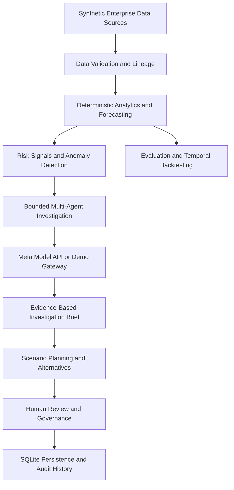

# LayoffLens AI

### Enterprise Workforce Resilience Intelligence Platform

**See the risks. Find the alternatives. Protect the workforce.**

LayoffLens AI is an AI-powered enterprise decision-support platform that helps organizations identify business and operational risks, investigate their potential causes, forecast business impacts, and evaluate preventive alternatives before considering workforce reductions.

The platform brings together financial performance, sales pipeline, project delivery, workforce capacity, hiring, AI transformation, and infrastructure signals in a coordinated intelligence and scenario-planning workflow.

Instead of automatically recommending layoffs, LayoffLens AI helps decision-makers understand business conditions, investigate risks, compare alternatives, review supporting evidence, and retain human control over employment-related decisions.

> **Demo data notice:** This submission uses synthetic, aggregate-only enterprise data. It does not perform individual employee termination scoring, automate employment decisions, or connect to live HR or payroll systems.

---

## 1. Key Features

- **Enterprise Intelligence:** Analyze financial performance, sales pipeline, project delivery, workforce capacity, and infrastructure signals.
- **Risk Detection:** Identify business anomalies, operational risks, and potential capacity mismatches.
- **Multi-Agent Investigation:** Coordinate bounded specialist workflows to investigate selected business events.
- **Meta AI Integration:** Optional Meta Model API integration for structured supervisor and specialist reasoning.
- **Business Forecasting:** Generate deterministic projections to help evaluate potential business outcomes.
- **Scenario Planning:** Compare baseline, downside, and preventive intervention scenarios.
- **Alternative Evaluation:** Explore illustrative options such as reskilling, redeployment, contractor optimization, spending reviews, and investment reallocation.
- **Evidence-Based Reviews:** Maintain investigation evidence, reviewer comments, decisions, and audit history.
- **External Research:** Optionally retrieve relevant public information through the Tavily API.

## 2. How It Works

1. **Collect:** Load and validate enterprise demonstration data.
2. **Detect:** Identify signals, anomalies, and potential business risks.
3. **Investigate:** Execute a bounded investigation using relevant specialist workflows.
4. **Forecast:** Evaluate potential financial and operational outcomes.
5. **Simulate:** Compare baseline, downside, and preventive alternatives.
6. **Review:** Present findings and supporting evidence for human assessment.
7. **Record:** Preserve investigation and review history locally.

---

## 3. System Architecture



### Technology Stack

| Layer | Technologies |
|---|---|
| Backend | Python, FastAPI |
| Frontend | HTML, CSS, JavaScript |
| Analytics | Pandas, NumPy, deterministic forecasting |
| AI Integration | Meta Model API |
| Agent Orchestration | Bounded supervisor and specialist runtime |
| External Research | Optional Tavily API |
| Persistence | SQLite |
| Testing | Pytest |

---

## 4. Project Structure

The main project directories are organized as follows:

```text
LayoffLens-AI/
│
├── backend/
│   ├── app/
│   └── requirements.txt
│
├── frontend/
│   ├── index.html
│   ├── app.js
│   └── styles.css
│
├── data/
├── tests/
│   └── fixtures/
│
├── scripts/
├── docs/
│
├── .env.example
├── .gitignore
├── LICENSE
└── README.md
```

---

# 5. Installation and Setup

Follow these steps to run LayoffLens AI locally.

## Prerequisites

Install the following:

- Python 3.10 or later, subject to compatibility with the project's dependencies.
- pip (Python package installer).
- Git.
- A modern web browser.

Check your Python and pip installations:

```powershell
python --version
python -m pip --version
```

## Step 1: Clone the repository

Open Windows PowerShell:

```powershell
git clone YOUR_GITHUB_REPOSITORY_URL
cd LayoffLens-AI
```

Replace `YOUR_GITHUB_REPOSITORY_URL` with the URL of your public GitHub repository.

## Step 2: Create a virtual environment

```powershell
python -m venv .venv
```

Activate the environment:

```powershell
.\.venv\Scripts\Activate.ps1
```

If PowerShell blocks script execution, run:

```powershell
Set-ExecutionPolicy -Scope Process -ExecutionPolicy Bypass
.\.venv\Scripts\Activate.ps1
```

## Step 3: Install dependencies

Upgrade pip:

```powershell
python -m pip install --upgrade pip
```

Install the backend dependencies:

```powershell
python -m pip install -r backend/requirements.txt
```

## Step 4: Configure environment variables

Create a local environment file from the example:

```powershell
Copy-Item .env.example .env
```

Open `.env` and configure the settings you need.

### Environment configuration example

The following configuration uses the demonstration mode by default. A Meta API key is not required for the deterministic demo.

```env
# Application modes
META_MODEL_MODE=demo
WRI_AGENT_MODE=simulation

# Meta Model API
MODEL_API_KEY=
META_MODEL_ID=muse-spark-1.3
META_MODEL_BASE_URL=https://api.meta.ai/v1

# Optional specialist model overrides
META_SUPERVISOR_MODEL=
META_SIGNAL_MODEL=
META_RESEARCH_MODEL=
META_FINANCE_MODEL=
META_DEMAND_MODEL=
META_CAPACITY_MODEL=
META_OPERATIONS_MODEL=
META_SCENARIO_MODEL=
META_ALTERNATIVES_MODEL=
META_REVIEW_MODEL=
META_REPORTING_MODEL=

# Optional Tavily public research integration
TAVILY_API_KEY=
TAVILY_API_URL=https://api.tavily.com/search
WRI_RESEARCH_TIMEOUT_SECONDS=15

# Local database
WRI_DATABASE_PATH=

# Bounded agent execution
WRI_AGENT_TIMEOUT_SECONDS=20
WRI_AGENT_MAX_STEPS=12

# Optional local authentication and monitoring
WRI_AUTH_ENABLED=false
WRI_MONITOR_ENABLED=false
```

### Environment variable reference

| Variable | Description |
|---|---|
| `META_MODEL_MODE` | Selects Meta demo or live model mode. |
| `WRI_AGENT_MODE` | Selects simulation or live agent execution. |
| `MODEL_API_KEY` | Server-side Meta API credential. |
| `META_MODEL_ID` | Configured Meta model identifier. |
| `META_MODEL_BASE_URL` | Meta API base URL. |
| `TAVILY_API_KEY` | Optional Tavily API credential. |
| `WRI_DATABASE_PATH` | Optional local SQLite database path. |
| `WRI_AGENT_TIMEOUT_SECONDS` | Maximum agent execution timeout. |
| `WRI_AGENT_MAX_STEPS` | Maximum bounded investigation steps. |
| `WRI_AUTH_ENABLED` | Enables optional local demo authentication. |
| `WRI_MONITOR_ENABLED` | Enables optional local monitoring. |

**Important configuration notes:**

- Keep `META_MODEL_MODE=demo` and `WRI_AGENT_MODE=simulation` for the default demonstration.
- Live Meta inference requires an authorized API key and appropriate account access.
- Tavily integration is optional and requires a separate API key.
- Never commit your actual `.env` file or API credentials to GitHub.
- The Meta integration has been implemented and mock-tested, but live inference has not been verified in this submission.

**Note about `.env` loading:** The application must explicitly load `.env` values for the file to take effect. If the project does not yet include a dotenv loader, install `python-dotenv` and load the file during application startup, or configure the environment variables directly in PowerShell. Do not assume that creating `.env` automatically loads its values.

---

# 6. Running the Application

From the project root, activate your virtual environment and run:

```powershell
python -m uvicorn backend.app.main:app --host 127.0.0.1 --port 8000 --reload
```

Once the server starts, open these URLs in your browser:

| Service | URL |
|---|---|
| LayoffLens AI application | http://127.0.0.1:8000/ |
| FastAPI interactive documentation | http://127.0.0.1:8000/docs |

The application uses SQLite for local persistence of supported investigation and review information. The database is stored locally unless a different path is configured through `WRI_DATABASE_PATH`.

To stop the application, press:

```text
Ctrl + C
```

in the PowerShell terminal.

---

# 7. Running Tests and Validation

Run the complete test suite:

```powershell
python -m pytest -q
```

Run additional project validation:

```powershell
python -m compileall -q backend
```

Check frontend JavaScript syntax:

```powershell
node --check frontend/app.js
```

Run the submission validation script:

```powershell
python scripts/check_submission.py
```

These commands help validate the backend, frontend syntax, automated tests, and submission packaging.

---

# 8. Meta AI Integration

LayoffLens AI includes an optional integration with the Meta Model API.

The integration is designed to support structured supervisor and specialist reasoning within bounded investigation workflows.

Its responsibilities include:

- Configurable Meta model selection.
- Structured model requests and responses.
- Bounded model execution.
- Response validation.
- Deterministic fallback when live inference is unavailable.

**Numerical calculations and scenario results remain under the deterministic analytics engine.** Model-generated reasoning does not replace the underlying calculations or independently establish enterprise facts.

The default demo configuration does not make outbound Meta API requests.

Live Meta inference has not been verified in this submission. For additional implementation details, see:

`docs/meta-api-integration.md`

---

# 9. Data, Governance and Responsible Use

The current demonstration uses synthetic, aggregate-only enterprise data.

LayoffLens AI does not:

- Connect to actual company HR, payroll, or ERP accounts.
- Score named employees for termination.
- Recommend individual layoffs.
- Automatically make employment decisions.
- Replace management, legal, or human-resources review.

Scenario costs, savings, and preventive intervention estimates are illustrative assumptions, not guaranteed financial outcomes.

External public research is treated as contextual information. It is not considered verified internal enterprise evidence.

Human review and approval remain essential for decisions involving organizational changes and workforce planning.

---

# 10. Current Limitations and Future Work

LayoffLens AI is a hackathon implementation and decision-support foundation, not a fully deployed enterprise SaaS product.

Further work would be required for production deployment, including:

- Authorized enterprise data integrations.
- Organization-specific identity and access management.
- Production-grade tenant isolation and security.
- Real-world forecast validation and calibration.
- Data retention, privacy, and compliance controls.
- Production monitoring and deployment infrastructure.
- Live provider verification and operational reliability testing.

---

# 11. Hackathon Submission

| Detail | Information |
|---|---|
| Event | Meta Global AI Developer Hackathon 2026 |
| Track / Theme | Build for Your World |
| Project | LayoffLens AI |
| Category | Enterprise AI and Workforce Resilience |

LayoffLens AI explores how Meta AI-powered reasoning, coordinated investigation workflows, and explainable business analytics can help organizations identify risks earlier and evaluate alternatives before making workforce-related decisions.

**Demo video:** Add your three-minute demo video URL here.

**Public GitHub repository:** Add your repository URL here.

---

**Built for a future where business resilience and workforce protection go hand in hand.**
