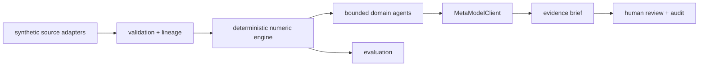

# LayoffLens AI

## Enterprise Workforce Resilience Intelligence Platform

**See the risks. Find the alternatives. Protect the workforce.**

LayoffLens AI is an independent Meta hackathon prototype for aggregate workforce and business planning. It turns synthetic finance, project, capacity, hiring, AI-investment, and infrastructure signals into a coordinated bounded workflow. Six deterministic specialists analyze the signals, compare reversible planning options, and produce an evidence-grounded brief. It is not an autonomous LLM-agent system, employee scoring tool, or employment decision system.

> **DEMO DATA — SYNTHETIC.** This does not score named employees, recommend terminations, or connect to HR/payroll systems.

## Run locally

```powershell
cd D:\CMB_Desktop\LayoffLens_AI
& C:\Users\MAHESH\anaconda3\python.exe -m pip install -r backend\requirements.txt
& C:\Users\MAHESH\anaconda3\python.exe -m uvicorn backend.app.main:app --reload
```

Open http://127.0.0.1:8000. The app creates a local `wri_demo.sqlite3` file for investigation and simulated review history; set `WRI_DATABASE_PATH` to use another file. Run tests with `& C:\Users\MAHESH\anaconda3\python.exe -m pytest -q`. No API key or paid service is required for the demo.

## Meta model mode

The default `META_MODEL_MODE=demo` is deterministic and visibly labeled **Demo fallback**. The demo makes no outbound Meta request. An optional live path exists behind `META_MODEL_MODE=live` and `MODEL_API_KEY`; live inference remains unverified for this submission and was not called because no authorized credential or credit approval was available. The key is server-side only. The live gateway uses the documented Meta Model API Responses endpoint, strict JSON schema output, and configurable model ID. Missing credentials, malformed output, unavailable service, timeouts, and rate limits produce a clearly labeled deterministic fallback. See [docs/meta-api-integration.md](docs/meta-api-integration.md) for official references and pricing/limit notes.

## End-to-end demo

Synthetic signals are validated into a reproducible versioned local snapshot, classified into a bounded event-dependent investigation path, analyzed by deterministic specialists, compared across baseline/downside/intervention scenarios, evaluated against mutually exclusive alternatives with explicit formulas and sensitivity bounds, converted into illustrative preventive options, summarized in demo fallback mode, and recorded with a simulated human review in SQLite. Evidence review is mandatory for a `complete` run; budget exhaustion is reported as `incomplete`, and failed or unsupported checks are `degraded`. Local event replay is available at `/api/events/replay`, prior runs at `/api/history`, and explicitly supplied outcome observations at `/api/outcomes`; descriptive projection comparisons are available at `/api/outcomes/compare/{investigation_id}`. Action costs are synthetic assumptions, not validated savings, and alternatives must not be added together. The adaptive workflow is documented in [docs/investigation-workflow.md](docs/investigation-workflow.md); the judge walkthrough is in [docs/demo-runbook.md](docs/demo-runbook.md) and the concise narrative is in [docs/demo-script.md](docs/demo-script.md).

Optional local monitoring is available only when explicitly enabled with
`WRI_MONITOR_ENABLED=true`. It polls one JSON snapshot, persists a content
fingerprint, suppresses unchanged content, and invokes the existing bounded
investigation only after a changed valid snapshot. It is local file polling,
not an enterprise connector or real-time monitoring system. See
[PHASE6I_IMPLEMENTATION_REPORT.md](PHASE6I_IMPLEMENTATION_REPORT.md).

## Connected multi-agent runtime

The investigation API now executes through a registered agent runtime rather
than a disconnected demonstration. The event-specific supervisor plan selects
the bounded specialists, validates tool permissions and dependencies, invokes
the existing deterministic calculation tools, and persists an execution trace.
Inspect the runtime with `GET /api/agents`, `GET /api/tools`, and
`GET /api/investigations/{run_id}/trace`. The frontend displays the actual
selected-agent trace.

The verified local mode is **deterministic simulation**: agent identities,
prompts, contracts, routing metadata, handoffs, and tool execution are real
application architecture, but no live model reasoning or external research is
claimed. See [docs/AGENT_ARCHITECTURE_TRANSFORMATION.md](docs/AGENT_ARCHITECTURE_TRANSFORMATION.md)
and [docs/AGENT_EXECUTION_FLOW.md](docs/AGENT_EXECUTION_FLOW.md).
The implementation details and verification are recorded in
[AGENT_RUNTIME_IMPLEMENTATION_REPORT.md](AGENT_RUNTIME_IMPLEMENTATION_REPORT.md).
Set `WRI_AGENT_MODE=live` only with an authorized `MODEL_API_KEY` to enable
structured supervisor and specialist model calls; this path is implemented and
mock-tested but not live-verified.

## Durable orchestration and evaluation

Investigation work is recorded in SQLite work items with queued, running,
completed, degraded, incomplete, and failed states. Source event IDs are
idempotent for normal intake, specialist results remain inspectable through
`/api/history`, and work timelines are available at `/api/work` and
`/api/work/{work_id}/timeline`. Explicit replay remains a distinct historical
run. This is a single-process local work record, not a distributed queue.

Persisted observations can be evaluated through `POST /api/evaluations` and
`GET /api/evaluations`. The temporal backtest requires comparable numeric
measures, excludes prediction leakage and invalid units with reasons, compares
the deterministic projection with a last-observation baseline when enough
history exists, and never promotes a policy automatically.

An optional local security mode can be enabled with
`WRI_AUTH_ENABLED=true`. It provides documented demo bearer tokens, reviewer
read access, operator/admin write access, a `demo-tenant` boundary, security
headers, and application-level SQLite audit events:

```powershell
$env:WRI_AUTH_ENABLED="true"
# Demo users: reviewer/reviewer-demo, operator/operator-demo, admin/admin-demo
```

Use `POST /api/auth/login` and send the returned bearer token plus
`X-WRI-Tenant: demo-tenant`. This is a local reference control, not SSO,
encryption-at-rest, immutable audit, or production security.

## Architecture



## Limitations

This is a hackathon vertical slice, not a validated forecasting product. The data is synthetic, action costs are illustrative assumptions, the evaluation window is synthetic, and the live Meta path was not tested without credentials. A real deployment needs identity, source connectors, privacy review, backtesting, retention controls, and human governance.

Production-planned capabilities include authorized enterprise connectors, SSO/RBAC, retention, tenant isolation, immutable audit, backtesting, drift monitoring, and deployment observability. See [IMPLEMENTATION_REPORT.md](IMPLEMENTATION_REPORT.md), [FINAL_SUBMISSION_READINESS.md](FINAL_SUBMISSION_READINESS.md), [docs/meta-api-integration.md](docs/meta-api-integration.md), and [docs/submission-checklist.md](docs/submission-checklist.md).
