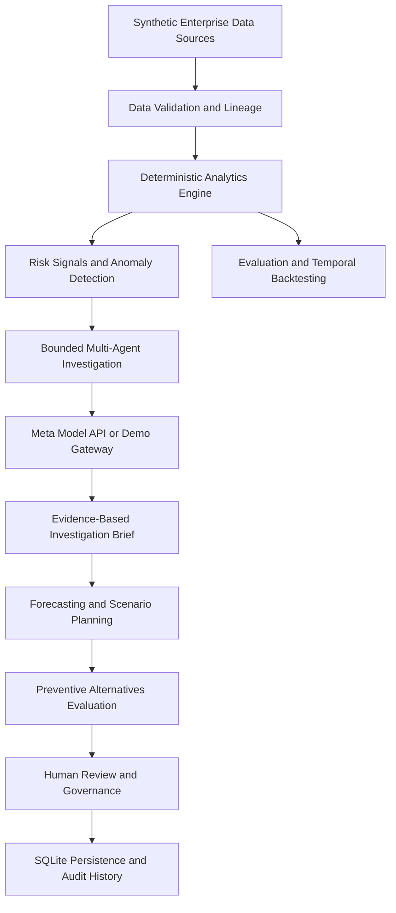

# LayoffLens AI [Open Live Application](https://tkdv9dm8-8011.inc1.devtunnels.ms/)
### Enterprise Workforce Resilience Intelligence Platform

**See the risks. Understand the causes. Explore alternatives. Protect the workforce.**

## 1. The Problem We Are Solving

When an organization faces financial pressure, declining revenue, delayed projects or increasing operating costs, workforce reductions can become one of the options considered by management.

But layoffs are often a response to underlying business problems rather than the original problem itself.

For example:

- Revenue may be declining because the sales pipeline is weakening.
- Projects may be delayed because the organization has a mismatch between required and available skills.
- Infrastructure costs may be increasing because cloud resources are inefficiently utilized.
- AI transformation may change the skills and capacity required by different business units.
- Hiring and project commitments may no longer match the organization's financial outlook.

If management identifies these problems too late, it may consider workforce reductions without fully understanding the available alternatives.

**The challenge:** How can organizations identify business risks earlier, understand their root causes, and evaluate alternatives before making workforce reduction decisions?

## 2. Our Solution: LayoffLens AI

LayoffLens AI is an AI-powered enterprise decision-support platform designed to help organizations understand business and operational pressure before it turns into avoidable workforce reductions.

It connects business intelligence, anomaly detection, forecasting, multi-agent investigation and scenario planning into one coordinated workflow.

Instead of simply reporting that a company is under financial or operational pressure, LayoffLens AI helps management investigate:

- What is going wrong?
- Which business areas are contributing to the problem?
- What could happen if the organization does nothing?
- Which projects, costs or capacity areas need attention?
- Are there alternatives to reducing the workforce?
- What could those alternatives cost, save or improve?
- What evidence supports each proposed action?

The platform helps management move from reactive workforce decisions towards proactive business and workforce planning.

> **Our core principle: Before reducing the workforce, understand the business problem and evaluate the alternatives.**

## 3. How LayoffLens AI Helps Prevent Avoidable Layoffs

LayoffLens AI follows a seven-stage decision-support process.

<AsyncImage query="enterprise workforce resilience business intelligence dashboard financial risk project analytics professional dark blue interface conceptual illustration" aspectRatio="16:9" width="100%" />

### Stage 1 — Monitor Enterprise Business Signals

The platform brings together information from multiple enterprise domains to build an overall picture of organizational health.

| Business domain | What LayoffLens AI examines |
|---|---|
| Finance | Revenue, expenses, margins and financial trends |
| Sales | Sales pipeline, demand and potential revenue changes |
| Projects | Delivery progress, project delays and workload |
| Workforce capacity | Aggregate workforce capacity and demand |
| Hiring | Hiring activity and workforce planning signals |
| Skills and learning | Skills availability and reskilling-related context |
| AI transformation | AI investment and potential productivity changes |
| Infrastructure | Cloud, GPU and operational infrastructure costs |
| Facilities | Operational and facility-related signals |
| External intelligence | Relevant public market and industry information |

The current hackathon demonstration uses synthetic, aggregate-only enterprise data. It does not connect to live company systems.

### Stage 2 — Detect Business Risks Early

LayoffLens AI analyzes business indicators and identifies anomalies, emerging risks and potential mismatches.

Examples include:

- Revenue declining over multiple reporting periods.
- Infrastructure expenditure increasing unexpectedly.
- Project delivery delays becoming more frequent.
- Sales demand weakening.
- Workforce capacity not matching project requirements.
- Changes in AI investment affecting operational planning.

The platform generates business signals with supporting information such as:

- Observed values and expected values.
- Risk severity.
- Detection method.
- Confidence information.
- Relevant evidence references.

This helps management identify where attention may be needed before making major organizational decisions.

### Stage 3 — Investigate Why the Problem Is Happening

Detecting a business risk is only the beginning. Management also needs to understand its potential causes.

LayoffLens AI uses a bounded multi-agent investigation runtime with a supervisor and specialist workflows.

Depending on the selected event, relevant specialists investigate different business areas, analyze available evidence and contribute findings to an investigation brief.

For example, if revenue is declining, an investigation may examine:

1. Financial performance and revenue trends.
2. Sales pipeline and demand signals.
3. Project delivery and operational conditions.
4. Workforce capacity and related business context.
5. Potential contributing factors and missing evidence.

For an infrastructure cost event, the investigation may focus on operational expenditure, infrastructure trends and related business signals.

The supervisor coordinates the investigation, manages bounded execution and validates the resulting evidence.

**The objective is to investigate the business problem, not to identify employees for termination.**

### Stage 4 — Forecast What Could Happen Next

After identifying business risks, LayoffLens AI uses deterministic forecasting and historical trends to evaluate potential future conditions.

The platform supports forecasting horizons including:

- 30 days
- 90 days
- 180 days
- 365 days

Examples of questions it helps explore:

- What could happen if revenue continues declining?
- Could infrastructure costs continue increasing?
- What happens if project delays continue?
- Is current aggregate workforce capacity aligned with projected project demand?
- Could financial pressure increase if no intervention is taken?

Forecasts provide an additional planning perspective. They are not guarantees of future performance.

### Stage 5 — Evaluate Alternatives Before Workforce Reductions

**This is the most important part of LayoffLens AI.**

Traditional business analysis may identify a problem and report that costs need to be reduced. LayoffLens AI takes the next step by helping management examine other possible interventions.

The platform supports illustrative preventive alternatives such as:

| Alternative | How it may help |
|---|---|
| Employee redeployment | Explore moving existing workforce capacity towards higher-priority business needs. |
| Reskilling and upskilling | Evaluate whether skill development can address capability gaps. |
| Hiring adjustments | Reassess future hiring plans against business demand. |
| Project reprioritization | Review lower-priority or delayed projects and reconsider resource allocation. |
| Contractor and vendor optimization | Examine external service and contractor expenditure. |
| Discretionary spending review | Identify spending areas that may be reconsidered. |
| Infrastructure optimization | Evaluate opportunities to improve cloud and infrastructure cost efficiency. |
| Investment reallocation | Consider shifting investment towards higher-priority business areas. |
| AI productivity investment | Explore whether suitable AI investments could improve operational efficiency. |

These alternatives are not automatic recommendations. They are options for management to examine against the available evidence and assumptions.

The objective is to determine whether business pressure can be addressed through operational improvements, better resource allocation or workforce development rather than immediately reducing headcount.

### Stage 6 — Compare Business Scenarios

LayoffLens AI provides scenario planning to help decision-makers compare possible outcomes.

For example:

| Scenario | What it represents |
|---|---|
| Baseline | Current business conditions and assumptions. |
| Downside | A more challenging business outlook. |
| Preventive intervention | Potential outcomes from selected cost, investment or operational interventions. |
| Combined preventive package | A combination of selected interventions, subject to assumptions and dependency limitations. |

Management can examine:

- Potential financial impact.
- Estimated intervention costs and savings.
- Operational implications.
- Workforce capacity considerations.
- Differences between scenarios.
- Assumptions and limitations.

**Example decision question:**

Suppose an organization faces increasing infrastructure costs and declining revenue.

Instead of immediately considering workforce reductions, management could examine whether infrastructure optimization, discretionary spending reviews, project reprioritization and investment reallocation could help improve the business outlook.

LayoffLens AI helps organize these alternatives and compare their illustrative outcomes.

The numbers generated by the current demonstration are based on synthetic data and configured assumptions. They should not be interpreted as guaranteed savings or real-world financial forecasts.

### Stage 7 — Human Review and Evidence-Based Decisions

Business decisions involving employees require accountability and human judgment.

LayoffLens AI includes a Human Review workflow that allows authorized users to review investigation findings, supporting evidence and scenario information.

The workflow supports:

- Investigation-linked review records.
- Evidence snapshots.
- Reviewer assignment and reassignment.
- Review comments.
- Evidence requests and submissions.
- Review lifecycle tracking.
- Activity history and audit records.

Possible review statuses include:

- Open
- In review
- Accepted
- Rejected
- Needs evidence
- Closed

The platform supports decision documentation and oversight. It does not automatically execute employment decisions or determine which employees should be terminated.

---

## 4. Example: How LayoffLens AI Works in a Realistic Business Situation

Consider a hypothetical organization experiencing financial pressure.

<box>
  <title size="lg">Business situation</title>
  <grid columns={2} gap={2}>
    <grid-item>
      <box border radius="lg" padding={3}>
        <text color="secondary" size="xs">Revenue</text>
        <title size="xl" color="danger">Declining</title>
        <caption>Financial pressure detected</caption>
      </box>
    </grid-item>
    <grid-item>
      <box border radius="lg" padding={3}>
        <text color="secondary" size="xs">Infrastructure costs</text>
        <title size="xl" color="danger">Increasing</title>
        <caption>Operational cost anomaly</caption>
      </box>
    </grid-item>
    <grid-item>
      <box border radius="lg" padding={3}>
        <text color="secondary" size="xs">Project delivery</text>
        <title size="xl" color="warning">Delayed</title>
        <caption>Delivery risk detected</caption>
      </box>
    </grid-item>
    <grid-item>
      <box border radius="lg" padding={3}>
        <text color="secondary" size="xs">Capacity planning</text>
        <title size="xl">Needs review</title>
        <caption>Potential demand mismatch</caption>
      </box>
    </grid-item>
  </grid>
  <caption>Illustrative situation, not actual company data.</caption>
</box>

**Without LayoffLens AI**

Management may see declining revenue and increasing expenditure and immediately begin considering workforce reductions as a cost-control measure.

**With LayoffLens AI**

1. The platform detects financial and operational risk signals.
2. The investigation runtime examines relevant business domains.
3. Forecasting helps evaluate possible future business conditions.
4. Scenario planning compares different intervention options.
5. Management examines alternatives such as infrastructure optimization, project reprioritization, reskilling and spending reviews.
6. Reviewers examine the supporting evidence and assumptions.
7. Authorized decision-makers decide which actions, if any, should be taken.

The goal is to help the organization discover whether its business problems can be addressed before resorting to workforce reductions.

LayoffLens AI does not guarantee that layoffs can always be avoided. Some business situations may still require difficult decisions. Its purpose is to make those decisions better informed and help organizations evaluate alternatives first.

## 5. What Makes LayoffLens AI Different?

Many business intelligence platforms focus on reporting what has already happened. Forecasting tools estimate what may happen next. Investigation tools help explain business events.

LayoffLens AI connects these capabilities to a workforce-resilience decision workflow.

| Typical business analytics | LayoffLens AI |
|---|---|
| Reports financial performance | Connects financial and operational signals. |
| Identifies business anomalies | Initiates relevant investigations. |
| Provides forecasts | Connects forecasts to scenario planning. |
| Reports cost increases | Helps evaluate preventive cost and operational alternatives. |
| Presents analysis | Supports evidence-based human review. |
| Focuses on business performance | Connects business resilience with aggregate workforce planning. |

Its key innovation is the connection between **early risk detection, AI-assisted investigation, deterministic business analysis, preventive scenario evaluation and human governance**.

It is designed to help organizations consider workforce protection as part of business resilience rather than treating layoffs as the first response to financial pressure.

## 6. Technical Architecture



### Key Technical Components

- **Enterprise data foundation:** Canonical data structures and synthetic datasets across multiple enterprise domains.
- **Intelligence engine:** Deterministic anomaly detection, business signals and forecasting.
- **Multi-agent runtime:** Bounded supervisor and specialist workflows, tool permissions, validation and investigation traces.
- **Scenario engine:** Baseline, downside and preventive intervention comparisons.
- **Governance workflow:** Evidence-backed reviews, reviewer assignments, comments and audit history.
- **Meta integration:** Optional structured model requests with validation and deterministic fallback.
- **External research:** Optional Tavily integration for contextual public information.

## 7. Technology Stack

| Layer | Technologies |
|---|---|
| Backend | Python, FastAPI |
| Frontend | HTML, CSS, JavaScript |
| Analytics | Pandas, NumPy, deterministic forecasting |
| AI integration | Meta Model API |
| Agent orchestration | Bounded supervisor and specialist runtime |
| External research | Optional Tavily API |
| Persistence | SQLite |
| Testing | Pytest |

## 8. Project Structure

```text
LayoffLens-AI/
│
├── backend/
│   ├── app/
│   └── requirements.txt
│
├── frontend/
│   ├── index.html
│   ├── app.js
│   └── styles.css
│
├── data/
├── tests/
│   └── fixtures/
│
├── scripts/
├── docs/
│
├── .env.example
├── .gitignore
├── LICENSE
└── README.md
```

---

# 9. Installation and Setup

## Prerequisites

- Python 3.10 or later, subject to dependency compatibility.
- pip.
- Git.
- A modern web browser.

Check your installations:

```powershell
python --version
python -m pip --version
```

## Step 1: Clone the repository

```powershell
git clone YOUR_GITHUB_REPOSITORY_URL
cd LayoffLens-AI
```

Replace `YOUR_GITHUB_REPOSITORY_URL` with your public GitHub repository URL.

## Step 2: Create a virtual environment

```powershell
python -m venv .venv
```

Activate it:

```powershell
.\.venv\Scripts\Activate.ps1
```

If PowerShell blocks activation:

```powershell
Set-ExecutionPolicy -Scope Process -ExecutionPolicy Bypass
.\.venv\Scripts\Activate.ps1
```

## Step 3: Install dependencies

```powershell
python -m pip install --upgrade pip
python -m pip install -r backend/requirements.txt
```

## Step 4: Configure environment variables

Create a local environment file:

```powershell
Copy-Item .env.example .env
```

Edit `.env` with the configuration you need.

### Example `.env`

```env
# Application modes
META_MODEL_MODE=demo
WRI_AGENT_MODE=simulation

# Meta Model API
MODEL_API_KEY=
META_MODEL_ID=muse-spark-1.3
META_MODEL_BASE_URL=https://api.meta.ai/v1

# Optional specialist model overrides
META_SUPERVISOR_MODEL=
META_SIGNAL_MODEL=
META_RESEARCH_MODEL=
META_FINANCE_MODEL=
META_DEMAND_MODEL=
META_CAPACITY_MODEL=
META_OPERATIONS_MODEL=
META_SCENARIO_MODEL=
META_ALTERNATIVES_MODEL=
META_REVIEW_MODEL=
META_REPORTING_MODEL=

# Optional Tavily research
TAVILY_API_KEY=
TAVILY_API_URL=https://api.tavily.com/search
WRI_RESEARCH_TIMEOUT_SECONDS=15

# Local database
WRI_DATABASE_PATH=

# Bounded agent execution
WRI_AGENT_TIMEOUT_SECONDS=20
WRI_AGENT_MAX_STEPS=12

# Optional local authentication and monitoring
WRI_AUTH_ENABLED=false
WRI_MONITOR_ENABLED=false
```

### Configuration notes

| Variable | Purpose |
|---|---|
| `META_MODEL_MODE` | Meta demo or live model mode |
| `WRI_AGENT_MODE` | Simulation or live agent execution |
| `MODEL_API_KEY` | Server-side Meta API credential |
| `META_MODEL_ID` | Configured Meta model identifier |
| `META_MODEL_BASE_URL` | Meta API base URL |
| `TAVILY_API_KEY` | Optional public research credential |
| `WRI_DATABASE_PATH` | Local SQLite database path |
| `WRI_AGENT_TIMEOUT_SECONDS` | Agent execution timeout |
| `WRI_AGENT_MAX_STEPS` | Maximum investigation steps |

**Important:**

- Demo mode is the default and does not require a Meta API key.
- Live Meta inference requires authorized API access and credentials.
- Tavily is optional.
- Never commit `.env` or API credentials to GitHub.
- The Meta integration has been implemented and mock-tested, but live inference has not been verified in this submission.
- A `.env` file is effective only if the application explicitly loads it. If no dotenv loader is present, configure variables in PowerShell or add and verify `python-dotenv` loading before relying on this file.

---

# 10. Run the Application

From the repository root, with the virtual environment activated:

```powershell
python -m uvicorn backend.app.main:app --host 127.0.0.1 --port 8000 --reload
```

Open the application:

- **Frontend:** http://127.0.0.1:8000/
- **API documentation:** http://127.0.0.1:8000/docs

SQLite is used for local persistence of supported investigation and review information.

Stop the application with `Ctrl + C`.

---

# 11. Run Tests

Run the complete test suite:

```powershell
python -m pytest -q
```

Additional checks:

```powershell
python -m compileall -q backend
node --check frontend/app.js
python scripts/check_submission.py
```

---

# 12. Meta AI Integration and Transparency

LayoffLens AI includes an optional Meta Model API integration for structured supervisor and specialist reasoning.

The integration supports configurable model selection, structured requests, response validation, bounded execution and deterministic fallback.

The deterministic analytics engine remains responsible for numerical calculations and scenario outputs.

The default demonstration does not make outbound Meta API requests. Live Meta inference has not been verified in this submission.

External public research through Tavily is optional. Public information provides context and is not treated as verified internal enterprise evidence.

For additional implementation details, see `docs/meta-api-integration.md`.

---

# 13. Responsible AI and Data Governance

LayoffLens AI is designed as a decision-support platform, not an automated employment decision system.

The current demonstration:

- Uses synthetic, aggregate-only enterprise data.
- Does not connect to actual company HR, payroll or ERP systems.
- Does not score named employees for termination.
- Does not recommend individual layoffs.
- Does not automate employment decisions.
- Keeps human review and authorization in the decision workflow.

Scenario costs, savings and preventive intervention estimates are illustrative assumptions, not guaranteed outcomes.

The platform aims to support transparent business analysis, evidence review and responsible workforce planning.

---

# 14. Current Limitations and Future Development

This is a hackathon implementation and a foundation for further development, not a fully deployed enterprise SaaS product.

Production deployment would require:

- Authorized enterprise data integrations.
- Organization-specific identity and access management.
- Production-grade tenant isolation and security.
- Real-world forecast validation and calibration.
- Data retention, privacy and compliance controls.
- Production monitoring and deployment infrastructure.
- Live provider verification and reliability testing.

---

# 15. Meta Global AI Developer Hackathon 2026

**Project:** LayoffLens AI — Enterprise Workforce Resilience Intelligence Platform

**Theme:** Build for Your World

**Problem addressed:** Helping organizations identify business risks early, investigate their causes and evaluate alternatives before making workforce reduction decisions.

The project explores how Meta AI-powered reasoning, coordinated investigation workflows and explainable business analytics can support more proactive and responsible enterprise workforce planning.

**Three-minute demo video:** Add your demo video URL here.

**Public GitHub repository:** Add your repository URL here.

---

**LayoffLens AI — Because protecting the workforce starts with understanding the business.**
